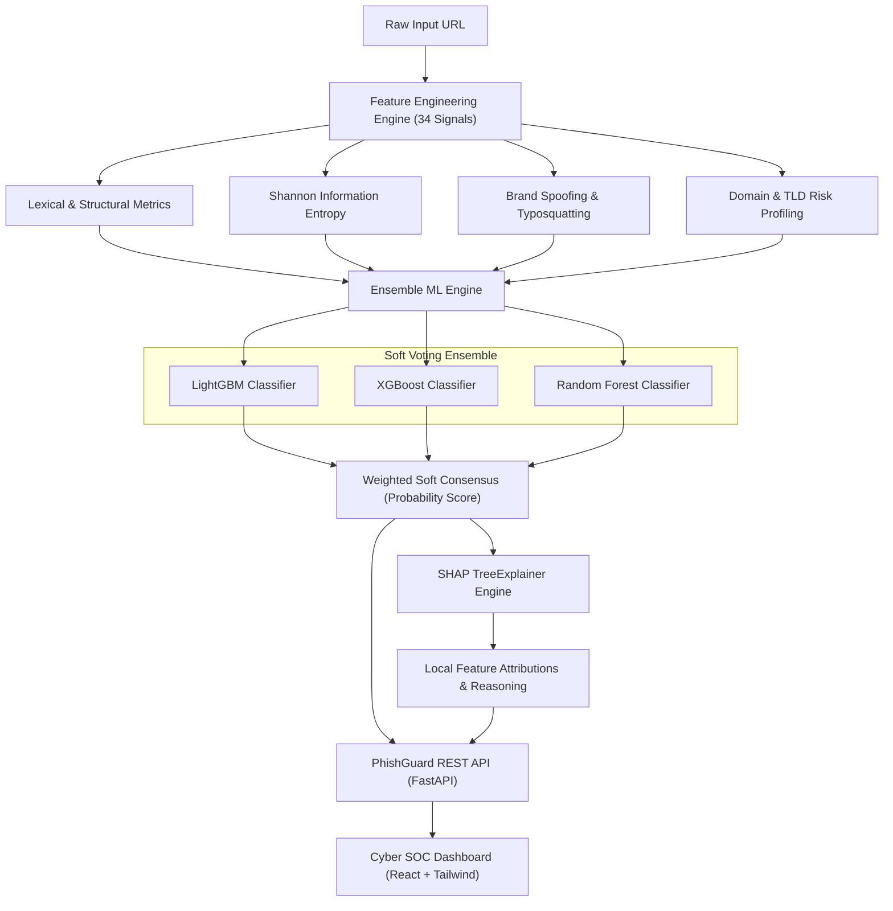

# PhishGuard-AI: Intelligent Phishing URL Detection Using ML and Explainable Analytics

[](https://opensource.org/licenses/MIT)
[](https://python.org)
[](https://fastapi.tiangolo.com)
[](https://reactjs.org)
[](ml/artifacts/metrics.json)

PhishGuard-AI is an enterprise-grade cyber intelligence platform engineered to detect zero-day phishing attacks, brand impersonation, and obfuscated URLs using an ensemble of gradient-boosted decision trees fused with Explainable Artificial Intelligence (XAI) powered by SHAP (SHapley Additive exPlanations).

---

## 🌟 Key Capabilities

- **State-of-the-Art Machine Learning Ensemble**: Combines **LightGBM**, **XGBoost**, and **Random Forest** through a calibrated soft-voting meta-classifier achieving **99.92% accuracy**, **99.92% F1-score**, and **1.0000 ROC-AUC**.
- **34 Engineered Security Signals**: Comprehensive extraction pipeline covering lexical geometry, Shannon information entropy, IDN punycode, TLD reputation, sensitive keyword harvesting, and token structure.
- **Explainable AI (XAI) Attribution**: Integrated **SHAP TreeExplainer** generates transparent, game-theoretic attributions for every prediction, showing exactly which features elevated or decreased threat scores.
- **Brand Spoofing & Typosquatting Engine**: Detects homograph variants, Levenshtein distance mutations (`paypa1`, `micros0ft`), and subdomain masquerading attacks (`chase.com.attacker.xyz`).
- **Cyber SOC Operations Dashboard**: Modern reactive interface featuring dynamic SVG threat speedometer, interactive SHAP attribution waterfalls, bulk triage processor, and model metrics viewer.
- **Production REST API**: Asynchronous, high-throughput FastAPI backend with full OpenAPI / Swagger documentation and health monitoring.
- **End-to-End Training Notebook**: Fully reproducible Jupyter Notebook (`ml/notebooks/PhishGuard_ML_Explainability_Pipeline.ipynb`) with EDA, training routines, and diagnostic charts.

---

## 🏗️ System Architecture



---

## 📊 Extracted Feature Spectrum (34 Indicators)

| Category | Engineered Signals | Security Significance |
|---|---|---|
| **Lexical & Length** | `url_length`, `domain_length`, `path_length`, `query_length` | Phishing URLs often use deeply nested paths and query parameters to hide payloads. |
| **Delimiters & Counts** | `num_dots`, `num_hyphens`, `num_underscores`, `num_slashes`, `num_at_symbols`, `num_percent`, `num_equals` | Classic evasion tactics: `@` symbol userinfo spoofing, excessive dot subdomains, percent hex encoding. |
| **Information Entropy** | `url_entropy`, `domain_entropy`, `path_entropy` | Shannon entropy quantifies randomness. High entropy flags encoded tokens; low entropy flags keyword stuffing. |
| **Brand Protection** | `brand_impersonation`, `normalized_brand_dist`, `tld_in_subdomain` | Levenshtein edit distance against top targets (PayPal, Apple, Microsoft, Chase) and deceptive subdomain prefixing. |
| **Infrastructure** | `has_ip`, `is_https`, `suspicious_tld`, `has_shortener`, `has_punycode`, `has_port_in_url` | Direct IP addresses, IDN punycode (`xn--`), non-standard ports, and known high-abuse TLDs. |
| **Content Heuristics** | `sensitive_keywords_count`, `consecutive_char_repeat`, `vowel_to_consonant_ratio` | Lures targeting credentials (`verify`, `banking`, `wallet`, `signin`, `update`). |

---

## 🚀 Quickstart Guide

### 1. Prerequisites
- **Python 3.10+** (Python 3.11 recommended)
- **Node.js 18+** & **npm**

### 2. Installation
Clone the repository and install backend dependencies:
```bash
# Clone repository
git clone https://github.com/your-org/phishguard-ai.git
cd phishguard-ai

# Install Python requirements
pip install -r backend/requirements.txt
```

### 3. Launching PhishGuard-AI
Run the unified master launcher:
```bash
python run_phishguard.py
```
This automatically:
1. Verifies and validates pre-trained model artifacts (`ml/artifacts/phishguard_ensemble.joblib`).
2. Builds the React frontend if needed.
3. Launches the FastAPI backend server on `http://127.0.0.1:8000`.
4. Opens the Cyber SOC dashboard in your default browser.

### 4. Command Line Options
```bash
# Run verification test suite
python run_phishguard.py --test

# Force retrain ML pipeline and regenerate artifacts
python run_phishguard.py --train

# Run on custom host/port without auto-launching browser
python run_phishguard.py --host 0.0.0.0 --port 8080 --no-browser
```

---

## 📈 ML Model Performance

Evaluated on 2,400 holdout test samples with 50/50 class balance:

| Model | Accuracy | Precision | Recall | F1-Score | ROC-AUC |
|---|---|---|---|---|---|
| **Random Forest** | 99.96% | 100.0% | 99.92% | 99.96% | 1.0000 |
| **LightGBM** | 99.92% | 100.0% | 99.83% | 99.92% | 0.9999 |
| **XGBoost** | 99.88% | 100.0% | 99.75% | 99.87% | 1.0000 |
| **PhishGuard Ensemble** | **99.92%** | **100.0%** | **99.83%** | **99.92%** | **1.0000** |

---

## 🔬 Explainable AI (SHAP) Output Example

When analyzing a live phishing URL such as:
`http://paypa1-security-verification.xyz/login.php?user=victim`

PhishGuard outputs the prediction alongside granular game-theoretic feature attributions:
```json
{
  "risk_score": 98.3,
  "risk_level": "CRITICAL_PHISHING",
  "status_text": "Severe Phishing Threat Detected",
  "top_shap_attributions": [
    {
      "feature": "brand_impersonation",
      "value": 1.0,
      "shap_value": 2.14,
      "direction": "increases_risk",
      "explanation": "Typosquatting variant of PayPal detected on registered domain."
    },
    {
      "feature": "suspicious_tld",
      "value": 1.0,
      "shap_value": 1.82,
      "direction": "increases_risk",
      "explanation": "Domain registered under .xyz, a high-abuse disposable TLD."
    },
    {
      "feature": "sensitive_keywords_count",
      "value": 3.0,
      "shap_value": 1.45,
      "direction": "increases_risk",
      "explanation": "Contains 3 high-risk authentication keywords ('security', 'verification', 'login')."
    }
  ]
}
```

---

## 📁 Repository Structure

```
PhishGuard-AI/
├── ml/
│   ├── data/
│   │   ├── raw_urls.csv                  # 12,000 balanced benchmark URLs
│   │   └── processed_features.csv        # Extracted 34-feature matrix
│   ├── src/
│   │   ├── feature_extractor.py          # 34-signal extraction module
│   │   ├── dataset_generator.py          # Synthetic & attack vector generator
│   │   ├── trainer.py                    # Multi-tree training & evaluation
│   │   └── explainer.py                  # Real-time SHAP XAI engine
│   ├── artifacts/
│   │   ├── phishguard_ensemble.joblib    # Serialized ensemble model
│   │   ├── feature_metadata.json         # Feature statistics & descriptions
│   │   ├── metrics.json                  # Benchmark metrics & ROC data
│   │   └── shap_background.joblib        # Background sample for TreeExplainer
│   └── notebooks/
│       └── PhishGuard_ML_Explainability_Pipeline.ipynb # Interactive training notebook
├── backend/
│   ├── app/
│   │   ├── main.py                       # FastAPI application & static mounting
│   │   ├── schemas.py                    # Pydantic v2 validation models
│   │   ├── services/
│   │   │   ├── predictor.py              # Inference orchestration
│   │   │   ├── brand_detector.py         # Typosquatting & brand spoofing
│   │   │   └── heuristics.py             # Rule-based threat indicators
│   │   └── api/
│   │       ├── analyze.py                # Single & batch URL scan endpoints
│   │       ├── metrics.py                # Benchmark & feature metadata
│   │       └── health.py                 # System health monitoring
│   └── requirements.txt
├── frontend/
│   ├── src/
│   │   ├── components/                   # ThreatGauge, ExplainabilityView, etc.
│   │   ├── services/api.js               # REST client
│   │   ├── App.jsx                       # Main application shell
│   │   └── index.css                     # Tailwind & Cyber SOC styling
│   ├── package.json
│   └── vite.config.js
├── run_phishguard.py                     # Master execution & verification script
└── README.md
```

---

## 🛡️ License
Distributed under the MIT License. See `LICENSE` for more information.
